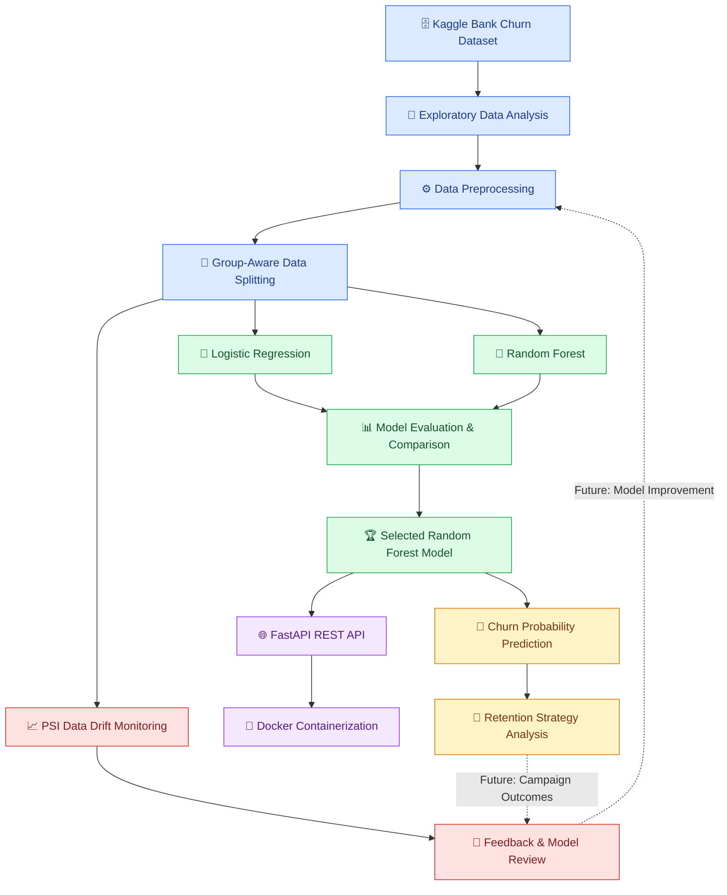

# JPMorganChase-Inspired Customer Churn Prediction & Retention Analytics

**End-to-End Machine Learning | Business Analytics | FastAPI | Docker | MLOps**

An end-to-end machine learning portfolio project focused on predicting customer churn, evaluating retention strategies, and building a reproducible ML workflow for the banking industry.

The project integrates exploratory data analysis, classification modeling, business sensitivity analysis, REST API development, Docker containerization, automated testing, and batch data drift monitoring.

> **Disclaimer:** This is an independent portfolio case study inspired by JPMorganChase as an illustrative business context. It is not affiliated with, sponsored by, or endorsed by JPMorganChase. The project uses publicly available synthetic data, not actual JPMorganChase customer information.

---

## 1. Project Overview

Customer churn occurs when customers discontinue their relationship with a business. In the banking industry, customer churn can reduce long-term customer value, increase customer acquisition costs, and negatively affect profitability.

This project develops a machine learning pipeline to identify customers at risk of churn and explore how predictive analytics can support customer retention decisions.

### Project Highlights

| Category | Results |
|---|---|
| Dataset | 165,034 synthetic banking customer records |
| Machine Learning | Logistic Regression and Random Forest |
| Best Validation ROC-AUC | **0.8870 — Random Forest** |
| Model Serving | FastAPI REST API |
| Containerization | Docker |
| Monitoring | Population Stability Index (PSI) |
| Automated Testing | 10 tests passed |
| Business Analytics | Customer retention sensitivity analysis |

### Business Objectives

1. Identify customers with a higher probability of churn.
2. Compare classification models using multiple evaluation metrics.
3. Understand the trade-offs between precision and recall.
4. Evaluate customer retention strategies under hypothetical business assumptions.
5. Develop a reproducible end-to-end machine learning workflow.
6. Demonstrate API deployment, containerization, and model monitoring.

---

## 2. End-to-End Machine Learning Pipeline

The following diagram illustrates the project workflow from data preparation to model predictions, retention decisions, monitoring, and future model improvement.



### Pipeline Components

| Stage | Description |
|---|---|
| Data Collection | Load synthetic banking customer data from Kaggle |
| Exploratory Data Analysis | Explore customer characteristics and churn patterns |
| Data Preprocessing | Prepare numerical and categorical features |
| Data Splitting | Use group-aware splitting to reduce customer-level leakage |
| Model Training | Train Logistic Regression and Random Forest |
| Model Evaluation | Compare accuracy, precision, recall, F1-score, and ROC-AUC |
| Churn Prediction | Generate customer churn probabilities |
| Business Analysis | Evaluate hypothetical retention campaign scenarios |
| API Deployment | Serve predictions through FastAPI |
| Containerization | Package the API using Docker |
| Model Monitoring | Detect feature distribution shifts using PSI |
| Feedback Loop | Support future model review and improvement |

**Note:** Solid arrows represent the implemented workflow. Dashed arrows represent proposed future feedback mechanisms. Actual campaign outcome integration and automatic retraining have not been implemented.

---

## 3. Dataset

**Dataset:** Binary Classification with a Bank Churn Dataset

**Source:** Kaggle Playground Series — Season 4, Episode 1

**Link:** https://www.kaggle.com/competitions/playground-series-s4e1/data

### Dataset Information

| Property | Value |
|---|---|
| Dataset | Binary Classification with a Bank Churn Dataset |
| Competition | Kaggle Playground Series S4E1 |
| File | `train.csv` |
| Total Records | 165,034 |
| Total Columns | 14 |
| Missing Values | 0 |
| Target Variable | `Exited` |
| Dataset Type | Synthetic |

### Target Variable

- `Exited = 1`: Customer churn
- `Exited = 0`: Customer does not churn

### Numerical Features

- `CreditScore`
- `Age`
- `Tenure`
- `Balance`
- `NumOfProducts`
- `HasCrCard`
- `IsActiveMember`
- `EstimatedSalary`

### Categorical Features

- `Geography`
- `Gender`

The columns `id`, `CustomerId`, and `Surname` are excluded from the predictive features.

`CustomerId` is used for group-aware splitting to reduce the risk of customer-level data leakage.

### Dataset Splitting

| Dataset | Records |
|---|---:|
| Training | 99,011 |
| Validation | 32,660 |
| Testing | 33,363 |
| **Total** | **165,034** |

The project uses `GroupShuffleSplit` with random seed `42`.

---

## 4. Project Structure

```text
customer-retention-ml-pipeline/
│
├── api/
│   └── main.py
│
├── src/
│   ├── bank_churn_analysis.py
│   ├── preprocess.py
│   ├── train_model.py
│   ├── train_random_forest.py
│   ├── compare_models.py
│   ├── business_sensitivity.py
│   └── monitor_model.py
│
├── tests/
│   ├── test_api.py
│   └── test_monitor_model.py
│
├── docs/
│
├── reports/
│
├── Dockerfile
├── .dockerignore
├── .gitignore
├── requirements.txt
└── README.md
```

The following files are created or stored locally when the workflow is executed:

```text
data/train.csv
artifacts/random_forest_pipeline.joblib
artifacts/monitoring_baseline.json
reports/monitoring_report.json
```

**Note:** Dataset files, trained model artifacts, and generated monitoring outputs may not be included in the public GitHub repository.

---

## 5. Technologies Used

| Category | Technologies |
|---|---|
| Programming | Python |
| Data Analysis | pandas, NumPy |
| Data Visualization | Matplotlib, Seaborn |
| Machine Learning | scikit-learn |
| Classification Models | Logistic Regression, Random Forest |
| Preprocessing | StandardScaler, OneHotEncoder, SimpleImputer |
| Data Splitting | GroupShuffleSplit |
| Model Serialization | joblib |
| API Development | FastAPI, Uvicorn |
| Containerization | Docker |
| Model Monitoring | Population Stability Index (PSI) |
| Automated Testing | pytest |
| Development Tools | Visual Studio Code, Git, GitHub |

---

# 6. How to Run the Project (macOS & Windows)

This section provides step-by-step instructions for running the complete machine learning pipeline on macOS and Windows.

Each step includes commands for both operating systems.

All commands should be executed from the repository root directory unless otherwise specified.

### Prerequisites

Install the following tools:

- Python 3.12 (recommended)
- Git
- Visual Studio Code (recommended)
- Docker Desktop (required for container deployment)

Official download links:

- Python: https://www.python.org/downloads/
- Git: https://git-scm.com/downloads
- Visual Studio Code: https://code.visualstudio.com/
- Docker Desktop: https://www.docker.com/products/docker-desktop/

The project has been tested locally on macOS using Python 3.14.10. The Docker image uses Python 3.12.

Windows instructions are provided for reproducibility but have not been independently tested.

### Step 1: Clone the Repository

**macOS — Terminal**

```bash
git clone https://github.com/nguyenmysan/customer-retention-ml-pipeline.git
cd customer-retention-ml-pipeline
```

**Windows — PowerShell**

```powershell
git clone https://github.com/nguyenmysan/customer-retention-ml-pipeline.git
cd customer-retention-ml-pipeline
```

### Step 2: Create a Virtual Environment

**macOS — Terminal**

```bash
python3 -m venv .venv
```

**Windows — PowerShell**

```powershell
py -m venv .venv
```

### Step 3: Activate the Virtual Environment

**macOS — Terminal**

```bash
source .venv/bin/activate
```

**Windows — PowerShell**

```powershell
.\.venv\Scripts\Activate.ps1
```

If PowerShell blocks activation, Windows users can run Python directly from the virtual environment by replacing `python` with `.\.venv\Scripts\python.exe` in subsequent commands.

### Step 4: Install Dependencies

**macOS — Terminal**

```bash
python -m pip install --upgrade pip
python -m pip install -r requirements.txt
```

**Windows — PowerShell**

```powershell
python -m pip install --upgrade pip
python -m pip install -r requirements.txt
```

### Step 5: Download the Dataset

Download `train.csv` from:

https://www.kaggle.com/competitions/playground-series-s4e1/data

Create the data directory if necessary.

**macOS — Terminal**

```bash
mkdir -p data
```

**Windows — PowerShell**

```powershell
New-Item -ItemType Directory -Force data
```

Place the downloaded file at:

```text
data/train.csv
```

The dataset is not included in the public repository.

### Step 6: Run Data Preprocessing

This step loads the dataset, prepares features, and checks group-aware data splitting.

**macOS — Terminal**

```bash
python src/preprocess.py
```

**Windows — PowerShell**

```powershell
python src/preprocess.py
```

### Step 7: Train Logistic Regression

Train the baseline classification model.

**macOS — Terminal**

```bash
python src/train_model.py
```

**Windows — PowerShell**

```powershell
python src/train_model.py
```

### Step 8: Train Random Forest

Train the Random Forest classification model.

**macOS — Terminal**

```bash
python src/train_random_forest.py
```

**Windows — PowerShell**

```powershell
python src/train_random_forest.py
```

The trained model is saved locally at:

```text
artifacts/random_forest_pipeline.joblib
```

This artifact is required for FastAPI and Docker deployment.

### Step 9: Compare Machine Learning Models

Compare Logistic Regression and Random Forest using validation metrics.

**macOS — Terminal**

```bash
python src/compare_models.py
```

**Windows — PowerShell**

```powershell
python src/compare_models.py
```

The comparison evaluates:

- Accuracy
- Precision
- Recall
- F1-score
- ROC-AUC

### Step 10: Run Business Sensitivity Analysis

Evaluate hypothetical customer retention scenarios under different business assumptions.

**macOS — Terminal**

```bash
python src/business_sensitivity.py
```

**Windows — PowerShell**

```powershell
python src/business_sensitivity.py
```

The analysis examines campaign costs, retention success rates, customer value, and classification thresholds.

### Step 11: Run MLOps Data Drift Monitoring

Run batch feature-drift monitoring using Population Stability Index (PSI).

**macOS — Terminal**

```bash
python -m src.monitor_model
```

**Windows — PowerShell**

```powershell
python -m src.monitor_model
```

Generated outputs include:

```text
artifacts/monitoring_baseline.json
reports/monitoring_report.json
```

The monitoring system uses a PSI alert threshold of `0.20`.

### Step 12: Run Automated Tests

Run the FastAPI and monitoring test suites.

**macOS — Terminal**

```bash
python -m pytest tests/ -v
```

**Windows — PowerShell**

```powershell
python -m pytest tests/ -v
```

Reported local macOS result:

```text
10 passed, 1 warning in 2.11s
```

The test suite contains:

- 6 FastAPI tests
- 4 MLOps monitoring tests

### Step 13: Start the FastAPI Application

Ensure that the Random Forest model has been trained.

**macOS — Terminal**

```bash
python -m uvicorn api.main:app --host 127.0.0.1 --port 8000
```

**Windows — PowerShell**

```powershell
python -m uvicorn api.main:app --host 127.0.0.1 --port 8000
```

Open the interactive API documentation:

http://127.0.0.1:8000/docs

Check API health:

http://127.0.0.1:8000/health

Expected healthy response:

```json
{
  "status": "healthy",
  "model_loaded": true,
  "model_name": "Random Forest"
}
```

### Step 14: Test the Prediction Endpoint

On either macOS or Windows:

1. Open `http://127.0.0.1:8000/docs`.
2. Select `POST /predict`.
3. Click `Try it out`.
4. Enter the JSON request below.
5. Click `Execute`.

**Example Request**

```json
{
  "CreditScore": 650,
  "Geography": "France",
  "Gender": "Female",
  "Age": 42,
  "Tenure": 5,
  "Balance": 125000,
  "NumOfProducts": 2,
  "HasCrCard": 1,
  "IsActiveMember": 1,
  "EstimatedSalary": 85000
}
```

**Example Response**

```json
{
  "churn_probability": 0.1279,
  "predicted_churn": 0,
  "risk_level": "Low",
  "threshold": 0.3,
  "recommended_action": "Continue standard customer engagement"
}
```

Prediction probabilities may change after retraining.

Stop the local FastAPI server using Ctrl+C before starting Docker on port 8000.

### Step 15: Build the Docker Image

Ensure Docker Desktop is installed and running.

**macOS — Terminal**

```bash
docker build -t bank-churn-api .
```

**Windows — PowerShell**

```powershell
docker build -t bank-churn-api .
```

The Docker image uses Python 3.12.

### Step 16: Run the Docker Container

The trained model is mounted from the local `artifacts/` directory.

**macOS — Terminal**

```bash
docker run --rm -p 8000:8000 -v "$(pwd)/artifacts:/app/artifacts:ro" bank-churn-api
```

**Windows — PowerShell**

```powershell
docker run --rm -p 8000:8000 --mount "type=bind,source=$((Get-Location).Path)\artifacts,target=/app/artifacts,readonly" bank-churn-api
```

On Windows, Docker Desktop should use Linux containers.

The model directory is mounted read-only and is not embedded in the Docker image.

### Step 17: Verify Docker Deployment

On either operating system, open:

**Swagger UI:** http://127.0.0.1:8000/docs

**Health Check:** http://127.0.0.1:8000/health

Expected response:

```json
{
  "status": "healthy",
  "model_loaded": true,
  "model_name": "Random Forest"
}
```

Test the `POST /predict` endpoint using the example JSON from Step 14.

Docker deployment was successfully tested locally on macOS.

Press Ctrl+C to stop the container.

### Step 18: Run Optional Exploratory Data Analysis

**macOS — Terminal**

```bash
python src/bank_churn_analysis.py
```

**Windows — PowerShell**

```powershell
python src/bank_churn_analysis.py
```

---

## 7. Data Preprocessing and Reproducibility

The preprocessing pipeline prepares numerical and categorical features for machine learning.

### Numerical Features

- Median imputation
- StandardScaler

### Categorical Features

- Most-frequent imputation
- OneHotEncoder

### Group-Aware Data Splitting

The project uses `GroupShuffleSplit` to reduce the risk of customer-level data leakage.

Records associated with the same `CustomerId` are kept within the same split.

**Random Seed:** 42

The preprocessing transformations are fitted using training data.

Trained machine learning pipelines are saved locally using joblib.

---

## 8. Machine Learning Model Performance

Two classification models were evaluated:

1. Logistic Regression
2. Random Forest

### Validation Results

**Classification Threshold: 0.50**

| Metric | Logistic Regression | Random Forest |
|---|---:|---:|
| Accuracy | 0.7581 | **0.8658** |
| Precision | 0.4525 | **0.7630** |
| Recall | **0.7391** | 0.5206 |
| F1-score | 0.5613 | **0.6189** |
| ROC-AUC | 0.8209 | **0.8870** |

### Model Comparison

Random Forest achieved higher validation accuracy, precision, F1-score, and ROC-AUC.

Logistic Regression achieved higher recall at the standard classification threshold.

Random Forest was selected for the FastAPI prediction service.

The API uses a decision threshold of `0.30` to explore a different balance between identifying at-risk customers and limiting unnecessary outreach.

These are validation metrics, not final untouched test-set results.

---

## 9. Customer Retention Business Analysis

The project explores how churn predictions can inform hypothetical customer retention campaigns.

### Business Assumptions

| Parameter | Value |
|---|---:|
| Contact Cost | $10 |
| Retention Success Rate | 20% |
| Retained Customer Value | $200 |
| Classification Threshold | 0.30 |

### Illustrative Business Result

**Estimated Net Value: $115,950**

This value is based on a hypothetical retention scenario using validation predictions and assumed business parameters.

It does not represent actual revenue, verified retention campaign performance, or JPMorganChase financial results.

### Business Interpretation

Predictive analytics can support customer prioritization by identifying individuals with a higher estimated risk of churn.

However, successful retention campaigns require additional evidence about intervention effectiveness, customer preferences, campaign costs, and operational constraints.

---

## 10. Production-Oriented ML Engineering

This project extends beyond model training by demonstrating practical machine learning engineering components.

### 10.1 FastAPI Model Serving

A REST API was developed using FastAPI to serve customer churn predictions.

**Features**

- Customer input validation
- Random Forest model loading
- Churn probability prediction
- Binary churn classification
- Risk level classification
- Suggested retention action
- Interactive Swagger documentation
- Automated endpoint testing

**API Endpoints**

| Method | Endpoint | Purpose |
|---|---|---|
| GET | `/` | Service information |
| GET | `/health` | API and model health |
| POST | `/predict` | Customer churn prediction |

**Verification**

- Local API startup completed successfully.
- Health endpoint returned model status.
- Prediction endpoint returned a churn prediction.
- All 6 FastAPI tests passed.

### 10.2 Docker Containerization

The FastAPI application was containerized using Docker.

**Implementation**

- Python 3.12 Docker environment
- API and dependency packaging
- Port 8000 exposure
- Read-only model artifact mounting
- Cross-platform execution instructions

**Verification**

- Docker image built successfully on macOS.
- Docker container started successfully.
- Health endpoint was verified.
- Prediction endpoint was verified.

### 10.3 MLOps Data Drift Monitoring

Batch data drift monitoring was implemented using Population Stability Index (PSI).

**Implementation**

- Training-data reference baseline
- Monitoring of 10 predictive features
- PSI calculation
- Configurable drift alert threshold
- JSON monitoring reports
- Simulated feature-drift detection
- Automated monitoring tests

**PSI Alert Threshold**

```text
PSI >= 0.20
```

**Monitoring Results**

| Test | Result |
|---|---|
| Validation Dataset | No drift alert |
| Simulated Age +20 Years | Drift detected |
| Simulated Age PSI | 8.002136 |
| Automated Monitoring Tests | 4 passed |

The monitoring workflow is batch-based. It does not implement continuous production monitoring or automatic retraining.

---

## 11. Automated Testing

The project uses pytest to validate API functionality and feature-drift monitoring.

### FastAPI Tests

- Root endpoint
- Health endpoint
- Successful prediction
- Missing input fields
- Invalid age
- Invalid credit card value

### MLOps Tests

- No drift on identical data
- Numerical feature drift detection
- Categorical feature drift detection
- Missing feature error handling

### Test Results

| Component | Passed |
|---|---:|
| FastAPI | 6/6 |
| MLOps | 4/4 |
| **Total** | **10/10** |

Reported local macOS result:

```text
10 passed, 1 warning in 2.11s
```

The warning was associated with a dependency deprecation and did not cause a test failure.

---

## 12. Troubleshooting

### Dataset Not Found

Download the Kaggle dataset and confirm that it is saved at:

```text
data/train.csv
```

### Model Artifact Not Found

Run:

```bash
python src/train_random_forest.py
```

Verify that the following file exists:

```text
artifacts/random_forest_pipeline.joblib
```

### Missing Python Dependencies

Activate the virtual environment and run:

```bash
python -m pip install -r requirements.txt
```

### Python Import Errors

Ensure commands are executed from the repository root.

### Port 8000 Already in Use

Stop the existing FastAPI server or Docker container before launching another service on port 8000.

### Docker Model Loading Error

Confirm that:

- Docker Desktop is running.
- The Random Forest model has been trained.
- The `artifacts/` directory exists.
- The Docker volume mount points to the correct directory.

### Windows PowerShell Activation Error

Run Python directly from the virtual environment:

```powershell
.\.venv\Scripts\python.exe -m pytest tests/ -v
```

---

## 13. Project Limitations

- The dataset is synthetic and does not represent real JPMorganChase customers.
- Validation performance does not guarantee performance on new customers.
- Churn predictions identify associations rather than causal reasons for customer attrition.
- Retention campaign outcomes are based on hypothetical assumptions.
- PSI monitoring does not directly measure model accuracy or fairness.
- Monitoring is batch-based rather than continuous.
- Automatic model retraining is not implemented.
- Real-world deployment would require additional security, privacy, fairness, regulatory, and operational validation.
- Final test-set evaluation should be completed after model selection.

---

## 14. Future Improvements

Potential future improvements include:

- Hyperparameter optimization
- Additional classification algorithms
- SHAP-based model explainability
- Probability calibration
- Customer segmentation
- Fairness and subgroup analysis
- Automated CI/CD workflows
- Cloud deployment
- Continuous model monitoring
- Automated retraining
- Interactive business intelligence dashboards
- Integration of actual customer retention campaign outcomes

These are proposed improvements, not currently implemented capabilities.

---

## 15. Project Resources

**GitHub Repository:**  
https://github.com/nguyenmysan/customer-retention-ml-pipeline

**Dataset:**  
https://www.kaggle.com/competitions/playground-series-s4e1/data

**Project Type:** Independent Machine Learning & Business Analytics Portfolio Case Study

**Industry:** Banking and Financial Services

**Core Skills:** Python, Data Analytics, Predictive Modeling, Machine Learning, Business Analytics, FastAPI, Docker, MLOps, Automated Testing

---

## 16. Project Scope & Disclaimer

This is an independent portfolio project using publicly available synthetic banking data.

JPMorganChase is referenced solely as an illustrative business context. The project is not affiliated with, sponsored by, or endorsed by JPMorganChase.

No proprietary JPMorganChase customer information was used.

The project demonstrates an analytical and engineering workflow and should not be interpreted as a production system deployed at a financial institution.

