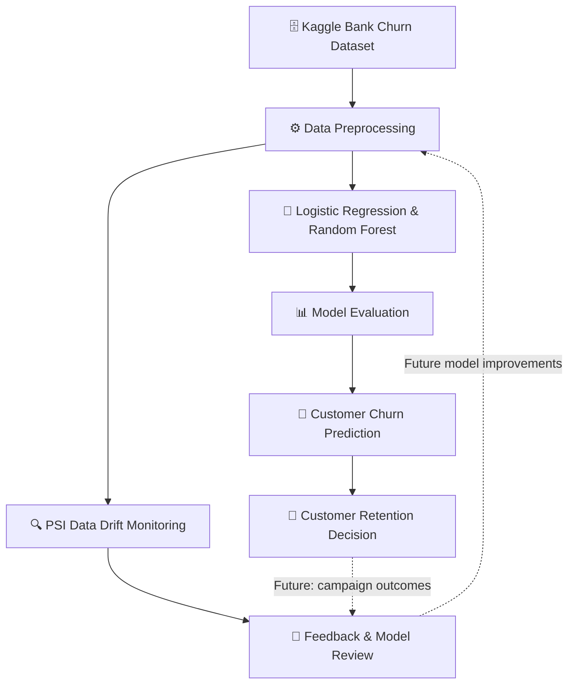

# JPMorganChase-Inspired Customer Churn Prediction & Retention Analytics

### End-to-End Machine Learning | Business Analytics | FastAPI | Docker | MLOps

An independent portfolio project demonstrating how machine learning and business analytics can support customer churn prediction, retention strategy development, and data-driven decision-making in the banking industry.

This project combines predictive modeling, customer risk assessment, business sensitivity analysis, REST API deployment, Docker containerization, and MLOps data drift monitoring.

> **Disclaimer:** This is an independent portfolio case study inspired by JPMorganChase as an illustrative banking context. It is not affiliated with, sponsored by, or endorsed by JPMorganChase. The project uses publicly available synthetic data, not actual JPMorganChase customer information.

---

## 1. Project Overview

Customer churn is a major business challenge in financial services. When customers discontinue banking relationships, financial institutions may lose future revenue and incur additional costs to acquire replacement customers.

This project develops an end-to-end machine learning workflow to identify customers at risk of churn and explore how predictive analytics can inform customer retention strategies.

### Project Highlights

- Analyzed **165,034 synthetic banking customer records**.
- Built and compared Logistic Regression and Random Forest classification models.
- Achieved **0.8870 validation ROC-AUC** with Random Forest.
- Evaluated customer retention strategies using hypothetical campaign economics.
- Developed a FastAPI REST API for customer churn predictions.
- Containerized the prediction service using Docker.
- Implemented PSI-based data drift monitoring.
- Verified 10 automated API and monitoring tests in a local macOS environment.

### Business Objectives

1. Identify customers with a higher probability of churn.
2. Compare classification models using appropriate performance metrics.
3. Evaluate the effect of prediction thresholds on retention targeting.
4. Estimate potential retention campaign outcomes using transparent assumptions.
5. Build a reproducible machine learning workflow.
6. Demonstrate model serving, containerization, and monitoring.

---

## 2. End-to-End Machine Learning Pipeline

The following diagram illustrates the workflow from data preparation to customer retention decisions and model monitoring.



### Pipeline Explanation

**1. Data Collection**

The project uses a publicly available synthetic bank churn dataset from Kaggle.

**2. Data Preprocessing**

Numerical and categorical features are prepared using imputation, scaling, and encoding. Group-aware splitting is used to reduce customer-level data leakage.

**3. Machine Learning**

Logistic Regression and Random Forest models are trained and evaluated to predict customer churn.

**4. Model Evaluation**

Models are compared using accuracy, precision, recall, F1-score, and ROC-AUC.

**5. Churn Prediction**

The selected Random Forest model generates churn probabilities through a FastAPI prediction endpoint.

**6. Business Decision**

Predicted churn probabilities support hypothetical customer retention targeting and campaign analysis.

**7. MLOps Monitoring**

Population Stability Index (PSI) is used to detect changes in feature distributions.

**8. Feedback Loop**

Monitoring results can inform model review. Integrating real campaign outcomes and automated retraining are proposed future improvements, not currently implemented features.

**Diagram interpretation:** Solid arrows represent the implemented analytical workflow. Dashed arrows represent proposed future feedback and model improvement activities.

---

## 3. Dataset

**Dataset:** Binary Classification with a Bank Churn Dataset

**Source:** Kaggle Playground Series — Season 4, Episode 1 (S4E1)

**Dataset Link:** https://www.kaggle.com/competitions/playground-series-s4e1/data

### Dataset Information

| Property | Value |
|---|---|
| Dataset | Binary Classification with a Bank Churn Dataset |
| Source | Kaggle Playground Series S4E1 |
| File | `train.csv` |
| Records | 165,034 |
| Columns | 14 |
| Missing Values | 0 |
| Target | `Exited` |
| Dataset Type | Synthetic |

### Target Variable

- `Exited = 1`: Customer churn
- `Exited = 0`: Customer does not churn

### Numerical Features

- `CreditScore`
- `Age`
- `Tenure`
- `Balance`
- `NumOfProducts`
- `HasCrCard`
- `IsActiveMember`
- `EstimatedSalary`

### Categorical Features

- `Geography`
- `Gender`

The columns `id`, `CustomerId`, and `Surname` are excluded from predictive features.

`CustomerId` is used for group-aware splitting to reduce the risk of customer-level data leakage.

### Dataset Splitting

| Dataset | Records |
|---|---:|
| Training | 99,011 |
| Validation | 32,660 |
| Testing | 33,363 |
| **Total** | **165,034** |

The project uses `GroupShuffleSplit` with random seed `42`.

---

## 4. Project Structure

```text
customer-retention-ml-pipeline/
│
├── api/
│   └── main.py
│
├── data/
│   └── train.csv
│
├── src/
│   ├── bank_churn_analysis.py
│   ├── preprocess.py
│   ├── train_model.py
│   ├── train_random_forest.py
│   ├── compare_models.py
│   ├── business_sensitivity.py
│   └── monitor_model.py
│
├── tests/
│   ├── test_api.py
│   └── test_monitor_model.py
│
├── artifacts/
│   ├── random_forest_pipeline.joblib
│   └── monitoring_baseline.json
│
├── reports/
│   └── monitoring_report.json
│
├── docs/
│
├── Dockerfile
├── .dockerignore
├── .gitignore
├── requirements.txt
└── README.md
```

**Note:** The dataset, trained model artifacts, and generated monitoring reports are stored locally and may not be committed to the public GitHub repository.

---

## 5. Technologies Used

| Category | Technologies |
|---|---|
| Programming | Python |
| Data Analysis | pandas, NumPy |
| Visualization | Matplotlib, Seaborn |
| Machine Learning | scikit-learn |
| Models | Logistic Regression, Random Forest |
| Preprocessing | StandardScaler, OneHotEncoder, SimpleImputer |
| Model Serialization | joblib |
| API | FastAPI, Uvicorn |
| Containerization | Docker |
| Monitoring | Population Stability Index (PSI) |
| Testing | pytest |
| Development | Visual Studio Code, Git, GitHub |

---

# 6. How to Run the Project (macOS & Windows)

This section provides step-by-step instructions for running the complete project on macOS and Windows.

Each step includes commands for both operating systems.

Run all commands from the repository root unless otherwise specified.

### Prerequisites

Install:

- Python 3.12 (recommended)
- Git
- Visual Studio Code (recommended)
- Docker Desktop (required for container deployment)

Download links:

- Python: https://www.python.org/downloads/
- Git: https://git-scm.com/downloads
- VS Code: https://code.visualstudio.com/
- Docker Desktop: https://www.docker.com/products/docker-desktop/

The project has been tested locally on macOS with Python 3.14.10. The Docker image uses Python 3.12. Windows instructions are provided but have not been independently tested.

### Step 1: Clone the Repository

**macOS — Terminal**

```bash
git clone https://github.com/nguyenmysan/customer-retention-ml-pipeline.git
cd customer-retention-ml-pipeline
```

**Windows — PowerShell**

```powershell
git clone https://github.com/nguyenmysan/customer-retention-ml-pipeline.git
cd customer-retention-ml-pipeline
```

### Step 2: Create a Virtual Environment

**macOS — Terminal**

```bash
python3 -m venv .venv
```

**Windows — PowerShell**

```powershell
py -m venv .venv
```

### Step 3: Activate the Virtual Environment

**macOS — Terminal**

```bash
source .venv/bin/activate
```

**Windows — PowerShell**

```powershell
.\.venv\Scripts\Activate.ps1
```

If PowerShell blocks activation, use `.\.venv\Scripts\python.exe` instead of `python` in subsequent Windows commands.

### Step 4: Install Dependencies

**macOS — Terminal**

```bash
python -m pip install --upgrade pip
python -m pip install -r requirements.txt
```

**Windows — PowerShell**

```powershell
python -m pip install --upgrade pip
python -m pip install -r requirements.txt
```

### Step 5: Download the Dataset

Download `train.csv` from:

https://www.kaggle.com/competitions/playground-series-s4e1/data

**macOS — Terminal**

```bash
mkdir -p data
```

**Windows — PowerShell**

```powershell
New-Item -ItemType Directory -Force data
```

Place the file at:

```text
data/train.csv
```

The dataset is not distributed with the repository.

### Step 6: Run Data Preprocessing

**macOS — Terminal**

```bash
python src/preprocess.py
```

**Windows — PowerShell**

```powershell
python src/preprocess.py
```

This step prepares features and checks the group-aware dataset splitting process.

### Step 7: Train Logistic Regression

**macOS — Terminal**

```bash
python src/train_model.py
```

**Windows — PowerShell**

```powershell
python src/train_model.py
```

This trains the baseline classification model.

### Step 8: Train Random Forest

**macOS — Terminal**

```bash
python src/train_random_forest.py
```

**Windows — PowerShell**

```powershell
python src/train_random_forest.py
```

The trained model is saved locally at:

```text
artifacts/random_forest_pipeline.joblib
```

This artifact is required before starting FastAPI or Docker.

### Step 9: Compare Models

**macOS — Terminal**

```bash
python src/compare_models.py
```

**Windows — PowerShell**

```powershell
python src/compare_models.py
```

The script compares Logistic Regression and Random Forest using validation performance metrics.

### Step 10: Run Business Sensitivity Analysis

**macOS — Terminal**

```bash
python src/business_sensitivity.py
```

**Windows — PowerShell**

```powershell
python src/business_sensitivity.py
```

This analysis evaluates hypothetical retention campaign economics under different assumptions.

### Step 11: Run MLOps Data Drift Monitoring

**macOS — Terminal**

```bash
python -m src.monitor_model
```

**Windows — PowerShell**

```powershell
python -m src.monitor_model
```

Generated outputs include:

```text
artifacts/monitoring_baseline.json
reports/monitoring_report.json
```

### Step 12: Run Automated Tests

**macOS — Terminal**

```bash
python -m pytest tests/ -v
```

**Windows — PowerShell**

```powershell
python -m pytest tests/ -v
```

Reported local macOS result:

```text
10 passed, 1 warning in 2.11s
```

The test suite includes six FastAPI tests and four monitoring tests.

### Step 13: Start the FastAPI Application

**macOS — Terminal**

```bash
python -m uvicorn api.main:app --host 127.0.0.1 --port 8000
```

**Windows — PowerShell**

```powershell
python -m uvicorn api.main:app --host 127.0.0.1 --port 8000
```

Open:

**Swagger UI:** http://127.0.0.1:8000/docs

**Health Check:** http://127.0.0.1:8000/health

Expected healthy response:

```json
{
  "status": "healthy",
  "model_loaded": true,
  "model_name": "Random Forest"
}
```

### Step 14: Test the Prediction Endpoint

On either macOS or Windows:

1. Open `http://127.0.0.1:8000/docs`.
2. Select `POST /predict`.
3. Click `Try it out`.
4. Enter the following JSON.
5. Click `Execute`.

**Example Request**

```json
{
  "CreditScore": 650,
  "Geography": "France",
  "Gender": "Female",
  "Age": 42,
  "Tenure": 5,
  "Balance": 125000,
  "NumOfProducts": 2,
  "HasCrCard": 1,
  "IsActiveMember": 1,
  "EstimatedSalary": 85000
}
```

**Example Response**

```json
{
  "churn_probability": 0.1279,
  "predicted_churn": 0,
  "risk_level": "Low",
  "threshold": 0.3,
  "recommended_action": "Continue standard customer engagement"
}
```

Prediction probabilities may change after retraining.

Stop the local FastAPI server with Ctrl+C before using port 8000 for Docker.

### Step 15: Build the Docker Image

Ensure Docker Desktop is installed and running.

**macOS — Terminal**

```bash
docker build -t bank-churn-api .
```

**Windows — PowerShell**

```powershell
docker build -t bank-churn-api .
```

### Step 16: Run the Docker Container

**macOS — Terminal**

```bash
docker run --rm -p 8000:8000 -v "$(pwd)/artifacts:/app/artifacts:ro" bank-churn-api
```

**Windows — PowerShell**

```powershell
docker run --rm -p 8000:8000 --mount "type=bind,source=$((Get-Location).Path)\artifacts,target=/app/artifacts,readonly" bank-churn-api
```

The trained model is mounted from the local `artifacts/` directory in read-only mode.

Windows users should configure Docker Desktop to use Linux containers.

### Step 17: Verify Docker Deployment

On either operating system, open:

**Swagger UI:** http://127.0.0.1:8000/docs

**Health Check:** http://127.0.0.1:8000/health

Expected response:

```json
{
  "status": "healthy",
  "model_loaded": true,
  "model_name": "Random Forest"
}
```

Test the prediction endpoint using the JSON request from Step 14.

Docker deployment was successfully tested locally on macOS.

### Step 18: Run Optional Exploratory Data Analysis

**macOS — Terminal**

```bash
python src/bank_churn_analysis.py
```

**Windows — PowerShell**

```powershell
python src/bank_churn_analysis.py
```

---

## 7. Data Preprocessing and Reproducibility

The preprocessing pipeline includes:

- Median imputation for numerical features.
- StandardScaler for numerical features.
- Most-frequent imputation for categorical features.
- OneHotEncoder for categorical features.
- Group-aware splitting using `CustomerId`.
- Random seed `42`.

The transformations are fitted on training data to reduce data leakage.

The trained machine learning pipeline is serialized using joblib.

---

## 8. Machine Learning Model Performance

Two classification models were evaluated:

1. Logistic Regression
2. Random Forest

### Validation Results

**Classification Threshold: 0.50**

| Metric | Logistic Regression | Random Forest |
|---|---:|---:|
| Accuracy | 0.7581 | **0.8658** |
| Precision | 0.4525 | **0.7630** |
| Recall | **0.7391** | 0.5206 |
| F1-score | 0.5613 | **0.6189** |
| ROC-AUC | 0.8209 | **0.8870** |

### Model Selection

Random Forest achieved higher validation accuracy, precision, F1-score, and ROC-AUC.

Logistic Regression achieved higher recall at the standard classification threshold.

Random Forest was selected for the prediction API.

The API uses a classification threshold of `0.30` to support a different trade-off between identifying at-risk customers and limiting outreach volume.

---

## 9. Business Retention Analysis

The project explores hypothetical customer retention campaigns based on predicted churn probabilities.

### Business Assumptions

| Parameter | Value |
|---|---:|
| Contact Cost | $10 |
| Retention Success Rate | 20% |
| Retained Customer Value | $200 |
| Classification Threshold | 0.30 |

### Illustrative Business Result

**Estimated Net Value: $115,950**

This figure represents a hypothetical scenario based on validation predictions and assumed retention economics.

It is not realized revenue, verified campaign effectiveness, or an actual JPMorganChase financial result.

---

## 10. Model Serving with FastAPI

A REST API was developed to provide customer churn predictions.

### API Features

- Customer input validation
- Random Forest model loading
- Churn probability prediction
- Binary churn classification
- Risk level classification
- Recommended retention action
- Swagger API documentation
- Automated endpoint testing

### API Endpoints

| Method | Endpoint | Purpose |
|---|---|---|
| GET | `/` | Service information |
| GET | `/health` | API and model health |
| POST | `/predict` | Customer churn prediction |

### Example Prediction

**Request**

```json
{
  "CreditScore": 650,
  "Geography": "France",
  "Gender": "Female",
  "Age": 42,
  "Tenure": 5,
  "Balance": 125000,
  "NumOfProducts": 2,
  "HasCrCard": 1,
  "IsActiveMember": 1,
  "EstimatedSalary": 85000
}
```

**Illustrative Response**

```json
{
  "churn_probability": 0.1279,
  "predicted_churn": 0,
  "risk_level": "Low",
  "threshold": 0.3,
  "recommended_action": "Continue standard customer engagement"
}
```

---

## 11. Containerized Deployment with Docker

The project uses Docker to package the FastAPI service and its Python dependencies.

### Implementation

- Python 3.12 Docker environment
- FastAPI and Uvicorn integration
- Containerized API service
- Port 8000 exposure
- Read-only model artifact mounting
- Reproducible deployment commands

### Verified Local Deployment

The following operations were successfully tested on macOS:

- Docker image build
- Container startup
- API health check
- Random Forest model loading
- Prediction endpoint

The model artifact is mounted from the host system rather than embedded in the Docker image.

---

## 12. MLOps and Data Drift Monitoring

The project implements batch feature-drift monitoring using Population Stability Index (PSI).

### Monitoring Workflow

1. Build a baseline from training data.
2. Compare validation data against the baseline.
3. Calculate PSI for predictive features.
4. Flag features exceeding the drift threshold.
5. Generate JSON monitoring reports.

### Drift Threshold

```text
PSI >= 0.20
```

PSI is a heuristic for detecting distribution changes and is not a formal statistical significance test.

### Monitoring Results

| Test | Result |
|---|---|
| Validation dataset | No drift detected |
| Simulated Age +20 years | Drift detected |
| Simulated Age PSI | 8.002136 |
| Monitoring tests | 4 passed |

### Generated Monitoring Files

```text
artifacts/monitoring_baseline.json
reports/monitoring_report.json
```

The implementation is batch-based and does not include continuous production monitoring or automatic model retraining.

---

## 13. Automated Testing

The project uses pytest to validate the API and monitoring components.

### FastAPI Tests

- Root endpoint
- Health endpoint
- Successful prediction
- Missing input fields
- Invalid age
- Invalid credit card value

### MLOps Tests

- No drift on identical data
- Numerical feature drift detection
- Categorical feature drift detection
- Missing feature error handling

### Reported Test Results

| Component | Passed |
|---|---:|
| FastAPI | 6/6 |
| MLOps | 4/4 |
| **Total** | **10/10** |

Local macOS execution:

```text
10 passed, 1 warning in 2.11s
```

The warning was associated with a dependency deprecation and did not cause a test failure.

---

## 14. Troubleshooting

### Dataset Not Found

Confirm that the Kaggle dataset is saved as:

```text
data/train.csv
```

### Model Artifact Not Found

Train the Random Forest model first:

```bash
python src/train_random_forest.py
```

Verify that the following file exists:

```text
artifacts/random_forest_pipeline.joblib
```

### Missing Dependencies

Activate the virtual environment and run:

```bash
python -m pip install -r requirements.txt
```

### Python Import Errors

Ensure commands are executed from the repository root and the virtual environment is active.

### Port 8000 Already in Use

Stop the existing FastAPI or Docker process before launching another server.

### Docker Model Loading Error

Confirm that:

- Docker Desktop is running.
- The Random Forest model has been trained.
- The `artifacts/` directory exists.
- The volume mount points to the correct local directory.

### Windows PowerShell Activation Error

Use the virtual environment's Python executable directly:

```powershell
.\.venv\Scripts\python.exe -m pytest tests/ -v
```

---

## 15. Project Limitations

- The dataset is synthetic and does not represent real JPMorganChase customers.
- Validation performance does not guarantee real-world performance.
- Churn predictions identify associations, not causal reasons for customer attrition.
- Retention campaign assumptions are hypothetical.
- PSI monitoring does not directly measure prediction accuracy or fairness.
- Monitoring is batch-based rather than continuous.
- Automatic model retraining is not implemented.
- Additional security, privacy, fairness, regulatory, and operational validation would be required before production deployment.
- Final test-set evaluation should be completed after model selection.

---

## 16. Future Improvements

Potential improvements include:

- Hyperparameter tuning
- Additional machine learning models
- SHAP-based model explainability
- Probability calibration
- Customer segmentation
- Fairness and subgroup analysis
- Real-time monitoring
- Automated retraining
- CI/CD integration
- Cloud deployment
- Interactive business intelligence dashboards
- Integration of actual customer retention campaign outcomes

These are proposed future improvements rather than currently implemented features.

---

## 17. Project Resources

**GitHub Repository:**  
https://github.com/nguyenmysan/customer-retention-ml-pipeline

**Dataset:**  
https://www.kaggle.com/competitions/playground-series-s4e1/data

**Project Type:** Independent Machine Learning and Business Analytics Portfolio Case Study

**Industry Context:** Retail Banking and Customer Retention

**Core Skills:** Python, Data Analysis, Machine Learning, Predictive Modeling, Business Analytics, FastAPI, Docker, MLOps, Automated Testing

---

## 18. Disclaimer

This is an independent portfolio case study using publicly available synthetic data.

JPMorganChase is referenced only as an illustrative business context. This project is not affiliated with, sponsored by, or endorsed by JPMorganChase.

No proprietary JPMorganChase customer information was used.


